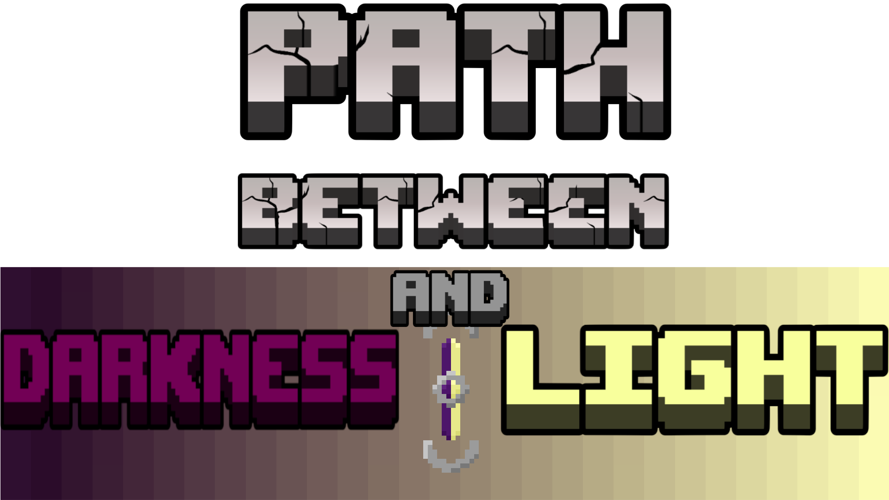

# Path between darkness and light

---

 

---

Ce mod a était crée par l'équipe _Path between darkness and light_, en utilisant MCreator, pour le concours [Jam Drops 2026](https://jamdrops.lairhisson.fr/), _Bloom and Gloom_.

## Description

Ce mod ajoute plusieurs fonctionnalitées interressante sur le thème de la lumière et de l'obscurité.

Le thème principale du mod : une jauge indiquant au joueur sont niveau de lumière. Cette jauge peut être augementer ou diminuer en fonction d'action du joueur.

### La jauge de lumière/obscurité

Une jauge affichant a l'utilisateur a quelle point il est dans la lumière ou dans l'obscurité.

Cette jauge est affiché au dessus de la barre de vie du joueur. Certain items peuvent faire monter ou déscendre cette jauge...

### Les gemmes

Il existe deux gemmes : gemme de lumière et gemme d'obscurité.

Ces gemmes peuvent être utiliser pour diminuer ou augementer la jauge de lumière. Lorsque le joueur fait un click droit sur la gemme de lumière, la jauge augement, a l'inverse, lorsque le joueur fait un click droit sur la gemme d'obscurité, la jauge diminue. Ces gemmes sont obtenues en battant les [boss de lumière et d'obscurité](#les-boss).

> Les gemmes peuvent aussi servire de monnaie d'échange entre les joueurs. Notament, si un joueur est interesser par la lumière, il pourrait échanger des gemmes d'obscurité contre des gemmes de lumière avec un autre joueur.

### Les boss

Il y a deux boss dans ce mod : le boss de lumière et le boss d'obscurité.

#### Le boss de lumière

Ce boss vie dans un temple de lumière. Le joueur doit donc trouver un temple pour le combatre. En mourant, le boss de lumière laisse tomber une [gemme de lumière](#les-gemmes), que le joueur peut utiliser pour augementer sa jauge de lumière.

##### Attaque

Le boss de lumière utilise une attaque a distance. Lors que le projectile tirer par le boss vous touche, un éclaire tombe du ciel sur vous ! Heureusement, le boss n'atteint pas toujours sa cible, et il est possible d'esquiver l'attaque si vous êtes rapide et que vous bouter tout le temps.

#### Le boss d'obscurité

Ce boss est l'oposé du boss de lumière. Il vie dans un temple d'obscurité. En mourant, le boss d'obscurité laisse tomber une [gemme d'obscurité](#les-gemmes), que le joueur peut utiliser pour diminuer sa jauge de lumière.

##### Attaque

Ce boss tire aussi un projectile, mais celui ci crée un troup sous vos pied !

Le boss de d'obscurité veux vous envoyer dans les ténèbres. Son rêve : vous faire traversser la couche de la bed rock pour vous envoyer dans le vide ! Heureusement, le troup n'est pas asser profond pour vous faire traverser la bed rock, mais suffisant pour vous tuer !

> Le trou a une largeur et profondeur variable. La profondeur varie entre 1 et 30 bloc, et la largeur varie entre 1 et 10 bloc.

#### Apparition en créatif

> Note: en survie, les boss se trouve uniquement dans les temples. En créatif, vous pouvez les faire apparaitre via les oeufs d'apparition...

### Les mobs

En plus des deux boss, ce mod ajoute des mobs.

#### Prêtre de lumière

Ce mob est l'asocié au boss de lumière. Il l'aide a répendre la lumière dans le monde, mais surtout a combattre le joueur !

Il existe deux variantes du prêtre de lumière : il peut soit combattre en tirant une orbe de lumière, soit en combat corps a corps.

#### Mob de lumière vs mob d'obscurité

Les mobs de lumière et d'obscurité se détestent bien évidement ! Il ne supportent pas d'être a moins d'une vaintaine blocs l'un de l'autre. Si cela se produit, ils se batteront (a mort !).

Tout les mobs de lumière (boss, prêtre...) et tout les mobs d'obscurité feront le combat.

> Vous pouvez bien sur utiliser cette stratégie pour les combattre plus facilement !

### Le temple de lumière et le temple d'obscurité

### Les blocs

Ce mod ajoute de nouveau bloc (et escalier, dalle, murret).

Il existe les bloc, dalle, escalier et murret de lumière et d'obscurité.

> Bien évidement, les bloc de lumière sont lumineux, et produisent beaucoup de lumière.

_En créatif, vous retrouverait ces bloc dans le menu créatif du mod..._

#### Crafting

### Les items

Ce mod ajoute beaucoup de nouveaux items. Il y a les [gemmes](#les-gemmes), les items de lumière et d'obscurité, mais d'autre items:

#### L'épée d'obscurité

> Cette épée est sombre et mistérieuse !

Avec elle, vous gagner un effet de force du moment que l'épée est dans votre main.

#### L'épée de lumière

> Cette épée est lumineuse et éclatante !

Avec elle, vous gagner plusieurs effets, du moment que l'épée est dans votre main :
- Vision nocturne
- PV supplémentaire
- Regénération
- Resistance

## Télécharger

Le mod est disponible sur Modrinth :

**[Page Modrinth](https://modrinth.com/project/jamdrops)**

Nous metton aussi a disposition les releases sur GitHub, pour les version beta et en teste :

**[Releases](https://github.com/smartin187/mod-Jam-Drops/releases)**

## License

**MIT License**

[LICENSE.md](LICENSE.md)
