# Path between darkness and light

---

---

## [**Télécharger le mod**](#télécharger)

---

Ce mod a été créé par l'équipe _Path between darkness and light_, en utilisant MCreator, pour le concours [Jam Drops 2026](https://jamdrops.lairhisson.fr/), _Bloom and Gloom_.

## Description

Ce mod ajoute plusieurs fonctionnalités intéressantes sur le thème de la lumière et de l'obscurité.

Le thème principal du mod : une jauge indiquant au joueur son niveau de lumière. Cette jauge peut être augmentée ou diminuée en fonction des actions du joueur.

### La jauge de lumière/obscurité

Une jauge indiquant à l'utilisateur à quel point il est dans la lumière ou dans l'obscurité.

Cette jauge est affichée au-dessus de la barre de vie du joueur. Certains items peuvent faire monter ou descendre cette jauge...

### Les gemmes

Il existe deux gemmes : gemme de lumière et gemme d'obscurité.

Ces gemmes peuvent être utilisées pour diminuer ou augmenter la jauge de lumière. Lorsque le joueur fait un clic droit sur la gemme de lumière, la jauge augmente ; à l'inverse, lorsque le joueur fait un clic droit sur la gemme d'obscurité, la jauge diminue. Ces gemmes sont obtenues en battant les [boss de lumière et d'obscurité](#les-boss).

> Les gemmes peuvent aussi servir de monnaie d'échange entre les joueurs. Notamment, si un joueur est intéressé par la lumière, il pourrait échanger des gemmes d'obscurité contre des gemmes de lumière avec un autre joueur.

_Une gemme de lumière et d'obsrucité :_
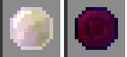

### Les boss

Il y a deux boss dans ce mod : le boss de lumière et le boss d'obscurité.

#### Le boss de lumière

Ce boss vit dans un temple de lumière. Le joueur doit donc trouver un temple pour le combattre. En mourant, le boss de lumière laisse tomber une [gemme de lumière](#les-gemmes), que le joueur peut utiliser pour augmenter sa jauge de lumière.

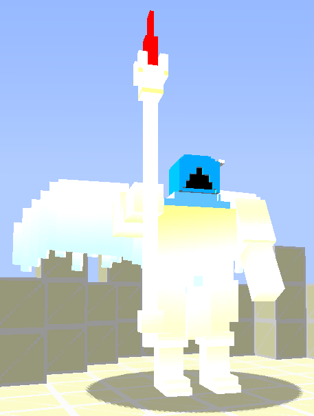

##### Attaque

Le boss de lumière utilise une attaque à distance. Lorsque le projectile tiré par le boss vous touche, un éclair tombe du ciel sur vous ! Heureusement, le boss n'atteint pas toujours sa cible, et il est possible d'esquiver l'attaque si vous êtes rapide et que vous bougez tout le temps.

#### Le boss d'obscurité

Ce boss est l'opposé du boss de lumière. Il vit dans un temple d'obscurité. En mourant, le boss d'obscurité laisse tomber une [gemme d'obscurité](#les-gemmes), que le joueur peut utiliser pour diminuer sa jauge de lumière.

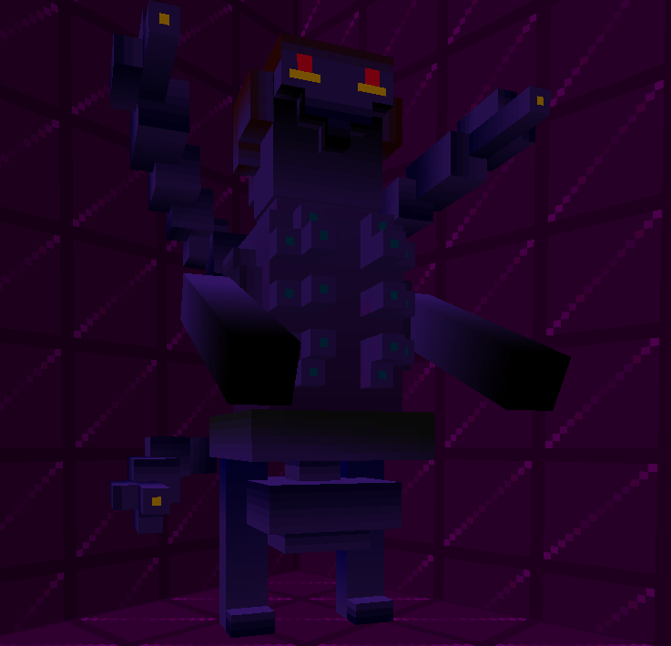

##### Attaque

Ce boss tire aussi un projectile, mais celui-ci crée un trou sous vos pieds !

Le boss d'obscurité veut vous envoyer dans les ténèbres. Son rêve : vous faire traverser la couche de la bedrock pour vous envoyer dans le vide ! Heureusement, le trou n'est pas assez profond pour vous faire traverser la bedrock, mais il est suffisamment profond pour vous tuer !

> Le trou a une largeur et une profondeur variables. La profondeur varie entre 1 et 30 blocs, et la largeur varie entre 1 et 10 blocs.

#### Invocation du boss

##### Dans les temples

Les boss se trouvent dans leur temple. Vous les trouverez donc en découvrant un temple.

##### Invoquer un boss

Il est possible d'invoquer un boss en utilisant un œuf d'apparition. Pour obtenir l'œuf, il faut avoir le niveau maximum de lumière ou d'obscurité dans la jauge. Ensuite, vous pouvez crafter l'œuf d'apparition du boss de lumière ou d'obscurité (selon que vous êtes au maximum de lumière ou d'obscurité).

> En créatif, vous pouvez les faire apparaître via les œufs d'apparition sans avoir besoin d'avoir le niveau maximum de lumière ou d'obscurité.

###### Crafting

_Invoquer un boss de lumière :_

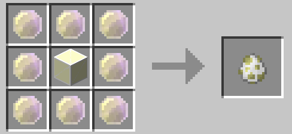

_Invoquer un boss d'obscurité :_

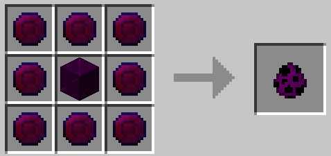

### Les mobs

En plus des deux boss, ce mod ajoute des mobs.

#### Prêtre de lumière

Ce mob est associé au boss de lumière. Il l'aide à répandre la lumière dans le monde, mais surtout à combattre le joueur !

Il existe deux variantes du prêtre de lumière : il peut soit combattre en tirant une orbe de lumière, soit en combat corps à corps.

#### Gardien de lumière

Ce mob est aussi associé au boss de lumière. Contrairement au prêtre de lumière, le gardien fait du combat au corps à corps. Il est donc un peu moins puissant que le prêtre de lumière.

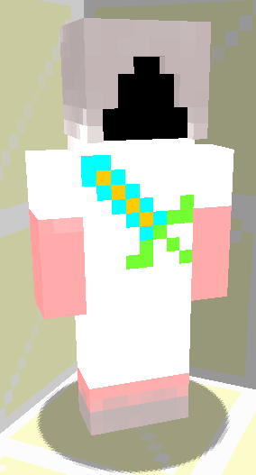

#### Prêtre de lumière heal

Cette variante du prêtre de lumière soigne les autres mobs. Il ne vous attaquera que si vous le frappez en premier, mais il est généralement accompagné d'autres mobs de lumière, qui, eux, vous attaqueront sans hésiter.

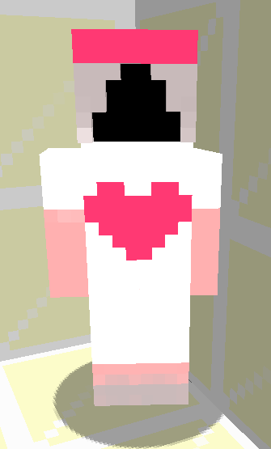

#### Mob de lumière vs mob d'obscurité

Les mobs de lumière et d'obscurité se détestent, bien évidemment ! Ils ne supportent pas d'être à moins d'une vingtaine de blocs l'un de l'autre. Si cela se produit, ils se battront (à mort !).

Tous les mobs de lumière (boss, prêtre...) et tous les mobs d'obscurité se battront.

> Vous pouvez bien sûr utiliser cette stratégie pour les combattre plus facilement !

### Le temple de lumière et le temple d'obscurité

Ces temples sont les lieux de vie des boss ainsi que des autres mobs associés aux boss.

#### Temple de lumière

Ce temple est une grande tour en bois, avec des blocs de lumière au sommet. Il y a 3 étages :
- Le premier étage est un parcours pour accéder au deuxième étage.
- Le deuxième étage est habité par les mobs de lumière, ils sont nombreux !
- Le troisième étage est le sommet de la tour, où veille le boss de lumière.

> Cette structure se trouve dans tous les biomes de l'overworld.

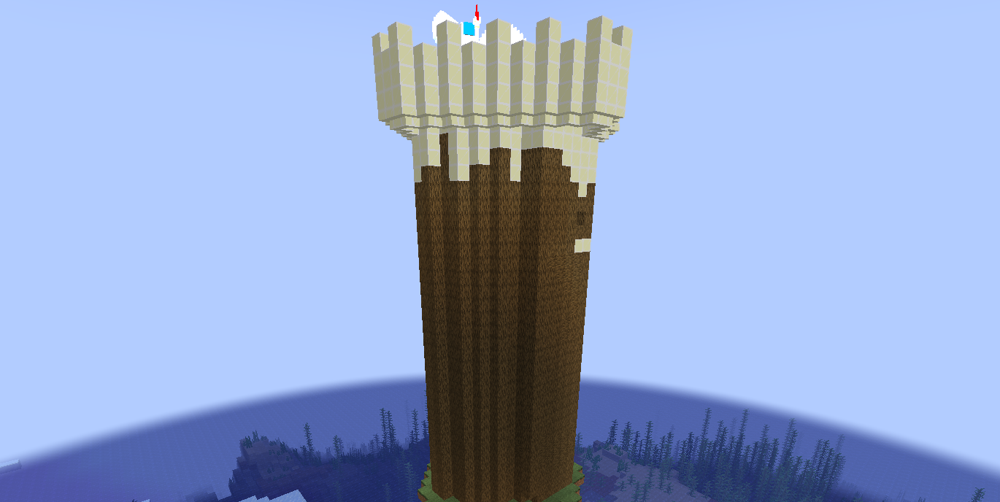

#### Temple d'obscurité

Ce temple est une piramide en blocs d'obscurité. Il y a 3 étages :
- Le premier étage est un grand espace sombre. A vous de découvrir ce qu'il cache
- Le second étage est la chambre du boss d'obscurité. Il fait très sombre là aussi. Vous devrait le combattre dans cette piece.
- Le troisième étage est le sommet de la pyramide. Malheureusement, il est abandonné depuis fort longtemps, il n'y a donc pas d'escalier ou échelle pour y monter. A vous de trouver un moyen d'y accéder !

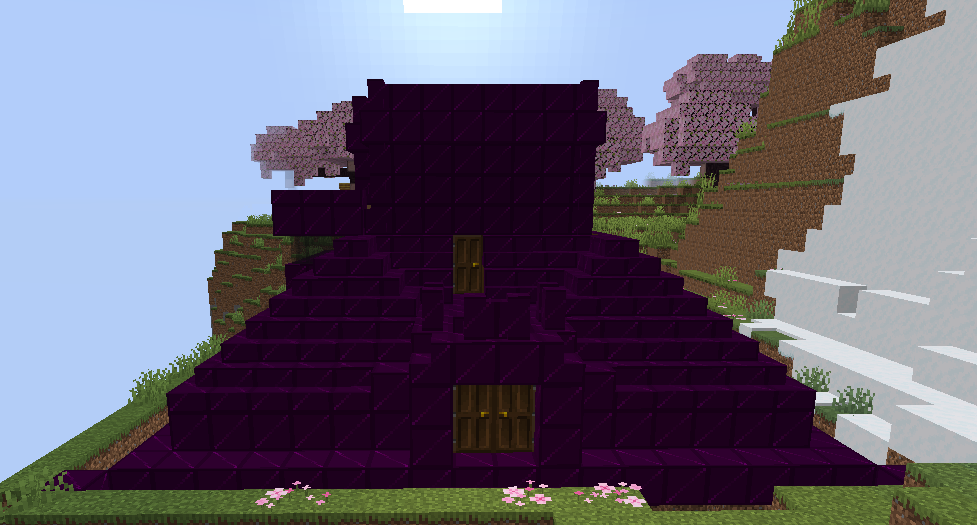

### Les blocs

Ce mod ajoute de nouveaux blocs (ainsi que des escaliers, des dalles et des murets).

Il existe des blocs, dalles, escaliers et murets de lumière et d'obscurité.

> Bien évidemment, les blocs de lumière sont lumineux et produisent beaucoup de lumière.

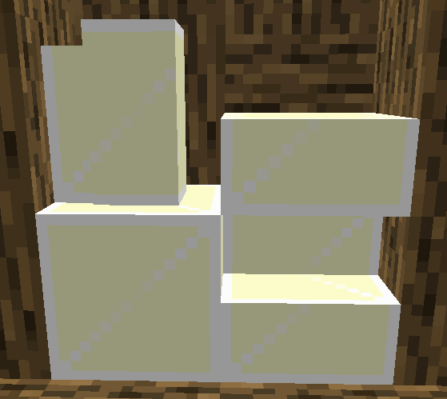
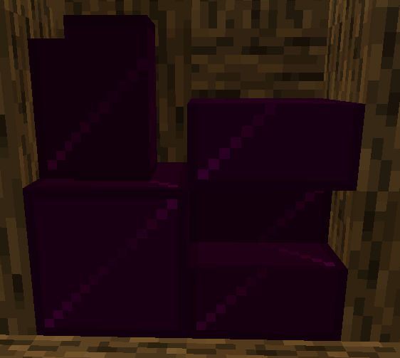

_En créatif, vous retrouverez ces blocs dans le menu créatif du mod..._

#### Crafting

Les blocs de lumière ou d'obscurité sont créés avec 4 gemmes de lumière ou d'obscurité. Ensuite, il est possible de les transformer en dalles, escaliers ou murets, comme avec les recettes des autres blocs du jeu, comme le bois.

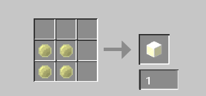
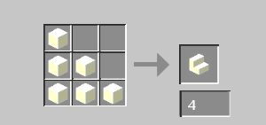
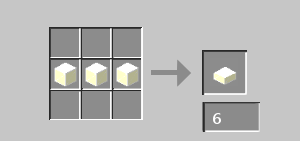
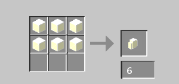

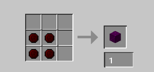
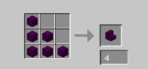
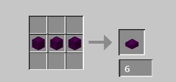
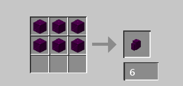

### Les items

Ce mod ajoute beaucoup de nouveaux items. Il y a les [gemmes](#les-gemmes), les items de lumière et d'obscurité, mais d'autres items :

#### L'épée d'obscurité

> Cette épée est sombre et mystérieuse !

Vous aurait l'effet de force lors que vous frappez un adversaire avec l'épée.

##### Crafting

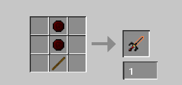

#### L'épée de lumière

> Cette épée est lumineuse et éclatante !

Avec elle, vous gagnez plusieurs effets tant que l'épée est dans votre main :
- Vision nocturne
- PV supplémentaire
- Résistance

##### Crafting

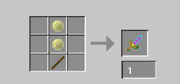

## Télécharger

Le mod est disponible sur Modrinth :

**[Page Modrinth](https://modrinth.com/project/path-between-darkness-and-light)**

Nous mettons aussi à disposition les releases sur GitHub, pour les versions bêta et en test :

**[Releases](https://github.com/smartin187/mod-Jam-Drops/releases)**

## License

**MIT License**

[LICENSE.md](LICENSE.md)
